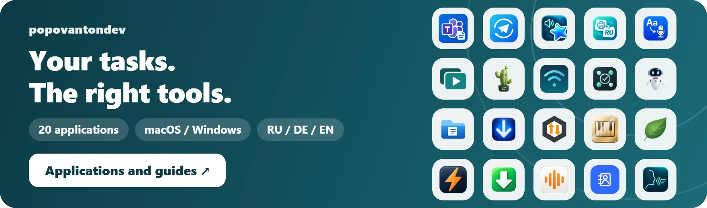
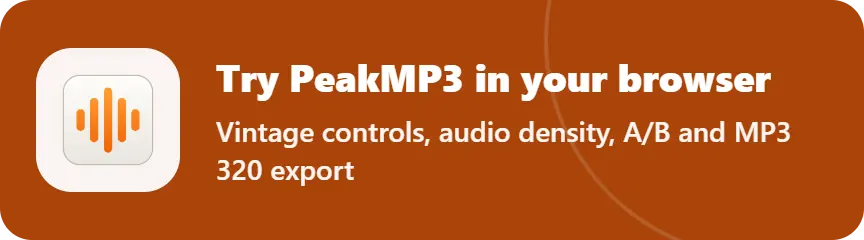
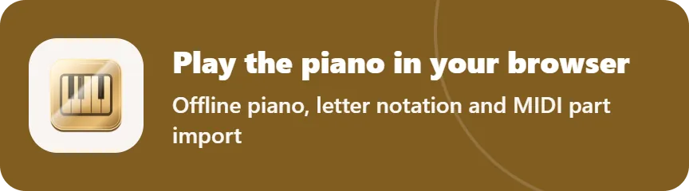
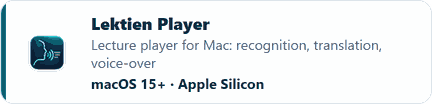
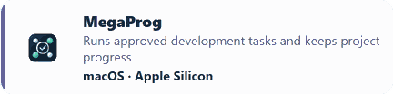
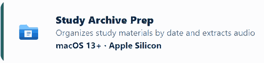

<a href="README.ru.md">Русский</a> · <a href="README.md">Deutsch</a> · <a href="README.en.md">English</a>

<a href="https://popovantondev.github.io/popovantondev/index-en.html"><picture><source media="(prefers-color-scheme: dark)" srcset="https://raw.githubusercontent.com/popovantondev/popovantondev/main/docs/readme/banner-en-dark.b0b9efa0.webp"></picture></a>

I build desktop tools for studying, working with media and managing everyday tasks on macOS and Windows. The catalog currently lists 20 applications.

**[→ Browse applications & guides](https://popovantondev.github.io/popovantondev/index-en.html)**

## Try it now

<a href="https://popovantondev.github.io/PeakMP3/index-en.html#demo"><picture><source media="(prefers-color-scheme: dark)" srcset="https://raw.githubusercontent.com/popovantondev/popovantondev/main/docs/readme/demo-peakmp3-en-dark.acf174da.webp"></picture></a>
<a href="https://popovantondev.github.io/VirtualPianoArranger/play-en.html"><picture><source media="(prefers-color-scheme: dark)" srcset="https://raw.githubusercontent.com/popovantondev/popovantondev/main/docs/readme/demo-piano-en-dark.8b775904.webp"></picture></a>

## All applications

### Learning

<a href="https://popovantondev.github.io/SaveLecture/index-en.html"><picture><source media="(prefers-color-scheme: dark)" srcset="https://raw.githubusercontent.com/popovantondev/popovantondev/main/docs/readme/card-SaveLecture-en-dark.831e344a.webp"></picture></a>
<a href="https://popovantondev.github.io/AnkiSound/index-en.html"><picture><source media="(prefers-color-scheme: dark)" srcset="https://raw.githubusercontent.com/popovantondev/popovantondev/main/docs/readme/card-AnkiSound-en-dark.301f8eb4.webp"></picture></a>
<a href="https://popovantondev.github.io/LectureTranslate/index-en.html"><picture><source media="(prefers-color-scheme: dark)" srcset="https://raw.githubusercontent.com/popovantondev/popovantondev/main/docs/readme/card-LectureTranslate-en-dark.e3b80b20.webp"></picture></a>
<a href="https://popovantondev.github.io/LectureCompanion/index-en.html"><picture><source media="(prefers-color-scheme: dark)" srcset="https://raw.githubusercontent.com/popovantondev/popovantondev/main/docs/readme/card-LectureCompanion-en-dark.aea8409e.webp"></picture></a>
<a href="https://popovantondev.github.io/QuickAnswer/index-en.html"><picture><source media="(prefers-color-scheme: dark)" srcset="https://raw.githubusercontent.com/popovantondev/popovantondev/main/docs/readme/card-QuickAnswer-en-dark.d6f0bac8.webp"></picture></a>
<a href="https://popovantondev.github.io/LektienPlayer/index-en.html"><picture><source media="(prefers-color-scheme: dark)" srcset="https://raw.githubusercontent.com/popovantondev/popovantondev/main/docs/readme/card-LektienPlayer-en-dark.75bb1b1e.webp"></picture></a>

### Media

<a href="https://popovantondev.github.io/SRTtoSound/index-en.html"><picture><source media="(prefers-color-scheme: dark)" srcset="https://raw.githubusercontent.com/popovantondev/popovantondev/main/docs/readme/card-SRTtoSound-en-dark.27987757.webp"></picture></a>
<a href="https://popovantondev.github.io/LectureMerge/index-en.html"><picture><source media="(prefers-color-scheme: dark)" srcset="https://raw.githubusercontent.com/popovantondev/popovantondev/main/docs/readme/card-LectureMerge-en-dark.7fb668ee.webp"></picture></a>
<a href="https://popovantondev.github.io/openmedia-downloader/index-en.html"><picture><source media="(prefers-color-scheme: dark)" srcset="https://raw.githubusercontent.com/popovantondev/popovantondev/main/docs/readme/card-openmedia-downloader-en-dark.d388e71e.webp"></picture></a>
<a href="https://popovantondev.github.io/VirtualPianoArranger/index-en.html"><picture><source media="(prefers-color-scheme: dark)" srcset="https://raw.githubusercontent.com/popovantondev/popovantondev/main/docs/readme/card-VirtualPianoArranger-en-dark.5398dd9b.webp"></picture></a>
<a href="https://popovantondev.github.io/SoundLeaf/index-en.html"><picture><source media="(prefers-color-scheme: dark)" srcset="https://raw.githubusercontent.com/popovantondev/popovantondev/main/docs/readme/card-SoundLeaf-en-dark.ea6daf26.webp"></picture></a>
<a href="https://popovantondev.github.io/YouTubeDownloader/index-en.html"><picture><source media="(prefers-color-scheme: dark)" srcset="https://raw.githubusercontent.com/popovantondev/popovantondev/main/docs/readme/card-YouTubeDownloader-en-dark.a4e974f8.webp"></picture></a>
<a href="https://popovantondev.github.io/PeakMP3/index-en.html"><picture><source media="(prefers-color-scheme: dark)" srcset="https://raw.githubusercontent.com/popovantondev/popovantondev/main/docs/readme/card-PeakMP3-en-dark.3b404d1b.webp"></picture></a>

### Tools

<a href="https://popovantondev.github.io/TelegramMediaSender/index-en.html"><picture><source media="(prefers-color-scheme: dark)" srcset="https://raw.githubusercontent.com/popovantondev/popovantondev/main/docs/readme/card-TelegramMediaSender-en-dark.629eae15.webp"></picture></a>
<a href="https://popovantondev.github.io/HotspotControl/index-en.html"><picture><source media="(prefers-color-scheme: dark)" srcset="https://raw.githubusercontent.com/popovantondev/popovantondev/main/docs/readme/card-HotspotControl-en-dark.e0a7ceeb.webp"></picture></a>
<a href="https://popovantondev.github.io/MegaProg/index-en.html"><picture><source media="(prefers-color-scheme: dark)" srcset="https://raw.githubusercontent.com/popovantondev/popovantondev/main/docs/readme/card-MegaProg-en-dark.135a87f3.webp"></picture></a>

### Data & backup

<a href="https://popovantondev.github.io/Kaktus-Backup-Sync/index-en.html"><picture><source media="(prefers-color-scheme: dark)" srcset="https://raw.githubusercontent.com/popovantondev/popovantondev/main/docs/readme/card-Kaktus-Backup-Sync-en-dark.a41f5000.webp"></picture></a>
<a href="https://popovantondev.github.io/StudyArchivePrep/index-en.html"><picture><source media="(prefers-color-scheme: dark)" srcset="https://raw.githubusercontent.com/popovantondev/popovantondev/main/docs/readme/card-StudyArchivePrep-en-dark.0063ed61.webp"></picture></a>
<a href="https://popovantondev.github.io/GitHubSync/index-en.html"><picture><source media="(prefers-color-scheme: dark)" srcset="https://raw.githubusercontent.com/popovantondev/popovantondev/main/docs/readme/card-GitHubSync-en-dark.34caa716.webp"></picture></a>
<a href="https://popovantondev.github.io/Kartoteka/index-en.html"><picture><source media="(prefers-color-scheme: dark)" srcset="https://raw.githubusercontent.com/popovantondev/popovantondev/main/docs/readme/card-Kartoteka-en-dark.924cc31c.webp"></picture></a>

Links to downloads, guides and bug reports

| Applications | Platform / Status | Links |
|---|---|---|
| [SaveLecture](https://popovantondev.github.io/SaveLecture/index-en.html) | Windows 11 · x64 Preview 0.1.0-preview.4 | [Download](https://github.com/popovantondev/SaveLecture/releases/tag/v0.1.0-preview.4) · [Source](https://github.com/popovantondev/SaveLecture) · [User guide](https://popovantondev.github.io/SaveLecture/Guide-en.html) · [Report a problem](https://github.com/popovantondev/SaveLecture/issues/new) |
| [Telegram Media Sender](https://popovantondev.github.io/TelegramMediaSender/index-en.html) | macOS 13+ · Apple Silicon Release 1.1.2 | [Download](https://github.com/popovantondev/TelegramMediaSender/releases/tag/v1.1.2) · [Source](https://github.com/popovantondev/TelegramMediaSender) · [User guide](https://popovantondev.github.io/TelegramMediaSender/Guide-en.html) · [Report a problem](https://github.com/popovantondev/TelegramMediaSender/issues/new/choose) |
| [Anki SOUND](https://popovantondev.github.io/AnkiSound/index-en.html) | macOS 13+ · Apple Silicon Release 3.4.11 | [Download](https://github.com/popovantondev/AnkiSound/releases/tag/v3.4.11) · [Source](https://github.com/popovantondev/AnkiSound) · [User guide](https://popovantondev.github.io/AnkiSound/Guide-en.html) · [Report a problem](https://github.com/popovantondev/AnkiSound/issues/new/choose) |
| [LectureTranslate](https://popovantondev.github.io/LectureTranslate/index-en.html) | macOS 15+ · Apple Silicon Release 3.5.1 | [Download](https://github.com/popovantondev/LectureTranslate/releases/tag/v3.5.1) · [Source](https://github.com/popovantondev/LectureTranslate) · [User guide](https://popovantondev.github.io/LectureTranslate/Guide-en.html) · [Report a problem](https://github.com/popovantondev/LectureTranslate/issues/new/choose) |
| [SRT to Sound](https://popovantondev.github.io/SRTtoSound/index-en.html) | macOS 15+ · Apple Silicon Release 3.5.0 | [Download](https://github.com/popovantondev/SRTtoSound/releases/tag/v3.5.0) · [Source](https://github.com/popovantondev/SRTtoSound) · [User guide](https://popovantondev.github.io/SRTtoSound/Guide-en.html) · [Report a problem](https://github.com/popovantondev/SRTtoSound/issues/new/choose) |
| [LectureMerge](https://popovantondev.github.io/LectureMerge/index-en.html) | macOS 14+ · Apple Silicon Release 2.2.0 | [Download](https://github.com/popovantondev/LectureMerge/releases/tag/v2.2.0) · [Source](https://github.com/popovantondev/LectureMerge) · [User guide](https://popovantondev.github.io/LectureMerge/Guide-en.html) · [Report a problem](https://github.com/popovantondev/LectureMerge/issues/new/choose) |
| [Kaktus Backup & Sync](https://popovantondev.github.io/Kaktus-Backup-Sync/index-en.html) | Windows · x64 Preview 5.2.0-preview.7 | [Download](https://github.com/popovantondev/Kaktus-Backup-Sync/releases/tag/v5.2.0-preview.7) · [Source](https://github.com/popovantondev/Kaktus-Backup-Sync) · [User guide](https://popovantondev.github.io/Kaktus-Backup-Sync/Guide-en.html) · [Report a problem](https://github.com/popovantondev/Kaktus-Backup-Sync/issues/new/choose) |
| [Hotspot Control](https://popovantondev.github.io/HotspotControl/index-en.html) | Windows 11 24H2+ · x64 Release 0.3.0 | [Download](https://github.com/popovantondev/HotspotControl/releases/tag/v0.3.0) · [Source](https://github.com/popovantondev/HotspotControl) · [User guide](https://popovantondev.github.io/HotspotControl/Guide-en.html) · [Report a problem](https://github.com/popovantondev/HotspotControl/issues/new/choose) |
| [MegaProg](https://popovantondev.github.io/MegaProg/index-en.html) | macOS · Apple Silicon Preview 4.5.1 | [Download](https://github.com/popovantondev/MegaProg/releases/tag/v4.5.1-preview.1) · [Source](https://github.com/popovantondev/MegaProg) · [User guide](https://popovantondev.github.io/MegaProg/Guide-en.html) · [Report a problem](https://github.com/popovantondev/MegaProg/issues/new/choose) |
| [Lecture Companion](https://popovantondev.github.io/LectureCompanion/index-en.html) | Windows 11 · x64 Preview 2.4 | [Download](https://github.com/popovantondev/LectureCompanion/releases/tag/v2.4) · [Source](https://github.com/popovantondev/LectureCompanion) · [User guide](https://popovantondev.github.io/LectureCompanion/Guide-en.html) · [Report a problem](https://github.com/popovantondev/LectureCompanion/issues/new/choose) |
| [Study Archive Prep](https://popovantondev.github.io/StudyArchivePrep/index-en.html) | macOS 13+ · Apple Silicon Source only 0.1.0 | [Source](https://github.com/popovantondev/StudyArchivePrep) · [User guide](https://popovantondev.github.io/StudyArchivePrep/Guide-en.html) · [Report a problem](https://github.com/popovantondev/StudyArchivePrep/issues/new/choose) |
| [OpenMedia Downloader](https://popovantondev.github.io/openmedia-downloader/index-en.html) | macOS 15+ · Apple Silicon Source only 5.5.0 | [Source](https://github.com/popovantondev/openmedia-downloader) · [User guide](https://popovantondev.github.io/openmedia-downloader/Guide-en.html) · [Report a problem](https://github.com/popovantondev/openmedia-downloader/issues/new/choose) |
| [GitHubSync](https://popovantondev.github.io/GitHubSync/index-en.html) | Windows 10/11 · x64 Release 1.5.3 | [Download](https://github.com/popovantondev/GitHubSync/releases/tag/v1.5.3) · [Source](https://github.com/popovantondev/GitHubSync) · [User guide](https://popovantondev.github.io/GitHubSync/Guide-en.html) · [Report a problem](https://github.com/popovantondev/GitHubSync/issues/new/choose) |
| [Virtual Piano Arranger](https://popovantondev.github.io/VirtualPianoArranger/index-en.html) | Windows · x64 Preview 0.1.0-preview.1 | [Download](https://github.com/popovantondev/VirtualPianoArranger/releases/tag/v0.1.0-preview.1) · [Source](https://github.com/popovantondev/VirtualPianoArranger) · [User guide](https://popovantondev.github.io/VirtualPianoArranger/Guide-en.html) · [Play in the browser](https://popovantondev.github.io/VirtualPianoArranger/play-en.html) · [Report a problem](https://github.com/popovantondev/VirtualPianoArranger/issues/new) |
| [SoundLeaf](https://popovantondev.github.io/SoundLeaf/index-en.html) | Windows 11 · x64 Preview 3.0.5 | [Download](https://github.com/popovantondev/SoundLeaf/releases/tag/v3.0.5) · [Source](https://github.com/popovantondev/SoundLeaf) · [User guide](https://popovantondev.github.io/SoundLeaf/Guide-en.html) · [Report a problem](https://github.com/popovantondev/SoundLeaf/issues/new/choose) |
| [Quick Answer](https://popovantondev.github.io/QuickAnswer/index-en.html) | Microsoft Edge · Windows Source only 1.7.8 | [Source](https://github.com/popovantondev/QuickAnswer) · [User guide](https://popovantondev.github.io/QuickAnswer/Guide-en.html) · [Report a problem](https://github.com/popovantondev/QuickAnswer/issues/new) |
| [YouTube Downloader](https://popovantondev.github.io/YouTubeDownloader/index-en.html) | Windows 7 SP1 / 10 / 11 · x86 / x64 Preview 2.6.0 | [Download](https://github.com/popovantondev/YouTubeDownloader/releases/tag/v2.6.0) · [Source](https://github.com/popovantondev/YouTubeDownloader) · [User guide](https://popovantondev.github.io/YouTubeDownloader/Guide-en.html) · [Report a problem](https://github.com/popovantondev/YouTubeDownloader/issues/new/choose) |
| [PeakMP3](https://popovantondev.github.io/PeakMP3/index-en.html) | Windows 7 SP1 / 10 / 11 · x86 / x64 Preview 0.16.0 | [Download](https://github.com/popovantondev/YouTubeDownloader/releases/tag/v2.6.0) · [Source](https://github.com/popovantondev/PeakMP3) · [User guide](https://popovantondev.github.io/PeakMP3/Guide-en.html) · [Try in browser](https://popovantondev.github.io/PeakMP3/index-en.html#demo) · [Report a problem](https://github.com/popovantondev/PeakMP3/issues/new) |
| [Kartoteka](https://popovantondev.github.io/Kartoteka/index-en.html) | Windows 11 · x64 Release 0.5.0 | [Download](https://github.com/popovantondev/Kartoteka/releases/tag/v0.5.0) · [Source](https://github.com/popovantondev/Kartoteka) · [User guide](https://popovantondev.github.io/Kartoteka/Guide-en.html) · [Report a problem](https://github.com/popovantondev/Kartoteka/issues/new) |
| [Lektien Player](https://popovantondev.github.io/LektienPlayer/index-en.html) | macOS 15+ · Apple Silicon Source only | [Source](https://github.com/popovantondev/LektienPlayer) · [User guide](https://popovantondev.github.io/LektienPlayer/Guide-en.html) · [Report a problem](https://github.com/popovantondev/LektienPlayer/issues/new) |

*PeakMP3 ships inside the YouTube Downloader installer, so the download link of PeakMP3 opens the YouTube Downloader release.*

## Interface previews

[SaveLecture](https://raw.githubusercontent.com/popovantondev/SaveLecture/main/docs/readme/preview-en-light.646f029d.webp) · [Telegram Media Sender](https://raw.githubusercontent.com/popovantondev/TelegramMediaSender/main/docs/readme/preview-en-light.e0397dc1.webp) · [Anki SOUND](https://raw.githubusercontent.com/popovantondev/AnkiSound/main/docs/readme/preview-en-light.4bf28c6e.webp) · [LectureTranslate](https://raw.githubusercontent.com/popovantondev/LectureTranslate/main/docs/readme/preview-en-light.5691191d.webp) · [SRT to Sound](https://raw.githubusercontent.com/popovantondev/SRTtoSound/main/docs/readme/preview-en-light.dde39e0b.webp) · [LectureMerge](https://raw.githubusercontent.com/popovantondev/LectureMerge/main/docs/readme/preview-en-light.e23321d9.webp) · [Kaktus Backup & Sync](https://raw.githubusercontent.com/popovantondev/Kaktus-Backup-Sync/main/docs/readme/preview-en-light.a101b40d.webp) · [Hotspot Control](https://raw.githubusercontent.com/popovantondev/HotspotControl/main/docs/readme/preview-en-light.669b84a3.webp) · [MegaProg](https://raw.githubusercontent.com/popovantondev/MegaProg/main/docs/readme/preview-en-light.7bee8bad.webp) · [Lecture Companion](https://raw.githubusercontent.com/popovantondev/LectureCompanion/main/docs/readme/preview-en-light.e7f6e739.webp) · [Study Archive Prep](https://raw.githubusercontent.com/popovantondev/StudyArchivePrep/main/docs/readme/preview-en-light.bac82131.webp) · [OpenMedia Downloader](https://raw.githubusercontent.com/popovantondev/openmedia-downloader/main/docs/readme/preview-en-light.1ea5fba0.webp) · [GitHubSync](https://raw.githubusercontent.com/popovantondev/GitHubSync/main/docs/readme/preview-en-light.cbaa78d1.webp) · [Virtual Piano Arranger](https://raw.githubusercontent.com/popovantondev/VirtualPianoArranger/main/docs/readme/preview-en-light.24a63a71.webp) · [SoundLeaf](https://raw.githubusercontent.com/popovantondev/SoundLeaf/main/docs/readme/preview-en-light.4f2d744b.webp) · [Quick Answer](https://raw.githubusercontent.com/popovantondev/QuickAnswer/main/docs/readme/preview-en-light.d823d2ae.webp) · [YouTube Downloader](https://raw.githubusercontent.com/popovantondev/YouTubeDownloader/main/docs/readme/preview-en-light.beaa6f34.webp) · [PeakMP3](https://raw.githubusercontent.com/popovantondev/PeakMP3/main/docs/readme/preview-en-light.a2865964.webp) · [Kartoteka](https://raw.githubusercontent.com/popovantondev/Kartoteka/main/docs/readme/preview-en-light.d8009063.webp) · [Lektien Player](https://raw.githubusercontent.com/popovantondev/LektienPlayer/main/docs/readme/preview-en-light.56139ecf.webp)

## Downloads & support

Open a program’s guide for requirements and first steps. Download the application from Releases, not the source-code ZIP. Preview releases are still being developed; source-only projects have no ready-to-install package.

For help or a bug report, use “Report a problem” in the application row. Include the application version, operating system and steps to reproduce the problem.

### Built with

C# · Python · Swift · WPF · PySide6 · .NET · [JavaScript — Quick Answer](https://popovantondev.github.io/QuickAnswer/index-en.html) · SwiftUI · Ruby · AppKit · PowerShell · Rust · egui · SQLite

Read the guide and release notes before use.
