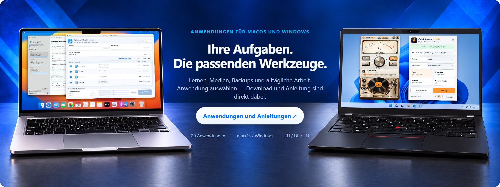
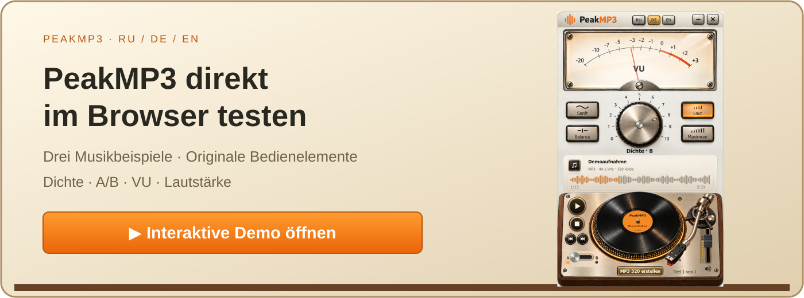

<a href="README.ru.md">Русский</a> · <a href="README.md">Deutsch</a> · <a href="README.en.md">English</a>

Ich entwickle Desktop-Anwendungen fürs Lernen, für Medien und für alltägliche Aufgaben unter macOS und Windows.

**[→ Anwendungen und Anleitungen entdecken](https://popovantondev.github.io/popovantondev/index.html)**

<table>
<tr>
<td width="50%" valign="top"> <a href="https://popovantondev.github.io/PeakMP3/index.html#demo"><b>▶ PeakMP3 im Browser testen</b></a></td>
<td width="50%" valign="top"> <a href="https://popovantondev.github.io/VirtualPianoArranger/play-de.html"><b>▶ Klavier im Browser spielen</b></a></td>
</tr>
</table>

## Ausgewählte Anwendungen

<table>
<tr>
<td width="50%" valign="top"><h3><a href="https://popovantondev.github.io/Kartoteka/index.html">Kartoteka</a></h3>
Verwalten Sie Kontakte, Sammlungen und andere Listen auf Ihrem eigenen Computer. Karten, Tabellen, eigene Felder, Fotos, Dokumente, Suche und Sicherungen in einer Anwendung.

Windows 11 · x64 Release 0.5.0

<a href="https://github.com/popovantondev/Kartoteka/releases/tag/v0.5.0">Herunterladen</a> · <a href="https://github.com/popovantondev/Kartoteka">Quellcode</a> · <a href="https://popovantondev.github.io/Kartoteka/Guide-de.html">Anleitung</a> · <a href="https://github.com/popovantondev/Kartoteka/issues/new">Fehler melden</a>
</td>
<td width="50%" valign="top"><h3><a href="https://popovantondev.github.io/Kaktus-Backup-Sync/index.html">Kaktus Backup &amp; Sync</a></h3>
Einseitige Ordnersicherung mit Vorschau und Aufbewahrung früherer Dateiversionen.

Windows · x64 Vorabversion 5.2.0-preview.7

<a href="https://github.com/popovantondev/Kaktus-Backup-Sync/releases/tag/v5.2.0-preview.7">Herunterladen</a> · <a href="https://github.com/popovantondev/Kaktus-Backup-Sync">Quellcode</a> · <a href="https://popovantondev.github.io/Kaktus-Backup-Sync/Guide-de.html">Anleitung</a> · <a href="https://github.com/popovantondev/Kaktus-Backup-Sync/issues/new/choose">Fehler melden</a>
</td>
</tr>
<tr>
<td width="50%" valign="top"><h3><a href="https://popovantondev.github.io/GitHubSync/index.html">GitHubSync</a></h3>
Überträgt Dateien zu GitHub und lädt Projektdateien oder Release-Dateien nach Bestätigung herunter.

Windows 10/11 · x64 Release 1.5.3

<a href="https://github.com/popovantondev/GitHubSync/releases/tag/v1.5.3">Herunterladen</a> · <a href="https://github.com/popovantondev/GitHubSync">Quellcode</a> · <a href="https://popovantondev.github.io/GitHubSync/Guide-de.html">Anleitung</a> · <a href="https://github.com/popovantondev/GitHubSync/issues/new/choose">Fehler melden</a>
</td>
<td width="50%" valign="top"><h3><a href="https://popovantondev.github.io/HotspotControl/index.html">Hotspot Control</a></h3>
Steuert den mobilen Windows-Hotspot und zeigt Geräte sowie Netzwerkeinstellungen.

Windows 11 24H2+ · x64 Release 0.3.0

<a href="https://github.com/popovantondev/HotspotControl/releases/tag/v0.3.0">Herunterladen</a> · <a href="https://github.com/popovantondev/HotspotControl">Quellcode</a> · <a href="https://popovantondev.github.io/HotspotControl/Guide-de.html">Anleitung</a> · <a href="https://github.com/popovantondev/HotspotControl/issues/new/choose">Fehler melden</a>
</td>
</tr>
<tr>
<td width="50%" valign="top"><h3><a href="https://popovantondev.github.io/TelegramMediaSender/index.html">Telegram Media Sender</a></h3>
Sendet nummerierte Pakete aus Video, Audio und Untertiteln in der gewählten Reihenfolge an Telegram.

macOS 13+ · Apple Silicon Release 1.1.2

<a href="https://github.com/popovantondev/TelegramMediaSender/releases/tag/v1.1.2">Herunterladen</a> · <a href="https://github.com/popovantondev/TelegramMediaSender">Quellcode</a> · <a href="https://popovantondev.github.io/TelegramMediaSender/Guide-de.html">Anleitung</a> · <a href="https://github.com/popovantondev/TelegramMediaSender/issues/new/choose">Fehler melden</a>
</td>
<td width="50%" valign="top"><h3><a href="https://popovantondev.github.io/AnkiSound/index.html">Anki SOUND</a></h3>
Ergänzt ausgewählte Anki-Karten um lokale Sprachausgabe und erstellt ein separat geprüftes Paket.

macOS 13+ · Apple Silicon Release 3.4.11

<a href="https://github.com/popovantondev/AnkiSound/releases/tag/v3.4.11">Herunterladen</a> · <a href="https://github.com/popovantondev/AnkiSound">Quellcode</a> · <a href="https://popovantondev.github.io/AnkiSound/Guide-de.html">Anleitung</a> · <a href="https://github.com/popovantondev/AnkiSound/issues/new/choose">Fehler melden</a>
</td>
</tr>
<tr>
<td width="50%" valign="top"><h3><a href="https://popovantondev.github.io/LectureTranslate/index.html">LectureTranslate</a></h3>
Übersetzt deutsche SRT-Untertitel ins Russische mit Zeitcodes, Warteschlange und Entwurfsprüfung.

macOS 15+ · Apple Silicon Release 3.5.1

<a href="https://github.com/popovantondev/LectureTranslate/releases/tag/v3.5.1">Herunterladen</a> · <a href="https://github.com/popovantondev/LectureTranslate">Quellcode</a> · <a href="https://popovantondev.github.io/LectureTranslate/Guide-de.html">Anleitung</a> · <a href="https://github.com/popovantondev/LectureTranslate/issues/new/choose">Fehler melden</a>
</td>
<td width="50%" valign="top"><h3><a href="https://popovantondev.github.io/LectureMerge/index.html">LectureMerge</a></h3>
Verbindet Vorlesungsvideo, Sprachausgabe, Originalton und Untertitel als MP4; exportiert auch Audio.

macOS 14+ · Apple Silicon Release 2.2.0

<a href="https://github.com/popovantondev/LectureMerge/releases/tag/v2.2.0">Herunterladen</a> · <a href="https://github.com/popovantondev/LectureMerge">Quellcode</a> · <a href="https://popovantondev.github.io/LectureMerge/Guide-de.html">Anleitung</a> · <a href="https://github.com/popovantondev/LectureMerge/issues/new/choose">Fehler melden</a>
</td>
</tr>
</table>

## Alle Anwendungen

| Programme | Plattform / Status | Links |
|---|---|---|
| [SaveLecture](https://popovantondev.github.io/SaveLecture/index.html) | Windows 11 · x64 Vorabversion 0.1.0-preview.4 | [Herunterladen](https://github.com/popovantondev/SaveLecture/releases/tag/v0.1.0-preview.4) · [Quellcode](https://github.com/popovantondev/SaveLecture) · [Anleitung](https://popovantondev.github.io/SaveLecture/Guide-de.html) · [Fehler melden](https://github.com/popovantondev/SaveLecture/issues/new) |
| [Telegram Media Sender](https://popovantondev.github.io/TelegramMediaSender/index.html) | macOS 13+ · Apple Silicon Release 1.1.2 | [Herunterladen](https://github.com/popovantondev/TelegramMediaSender/releases/tag/v1.1.2) · [Quellcode](https://github.com/popovantondev/TelegramMediaSender) · [Anleitung](https://popovantondev.github.io/TelegramMediaSender/Guide-de.html) · [Fehler melden](https://github.com/popovantondev/TelegramMediaSender/issues/new/choose) |
| [Anki SOUND](https://popovantondev.github.io/AnkiSound/index.html) | macOS 13+ · Apple Silicon Release 3.4.11 | [Herunterladen](https://github.com/popovantondev/AnkiSound/releases/tag/v3.4.11) · [Quellcode](https://github.com/popovantondev/AnkiSound) · [Anleitung](https://popovantondev.github.io/AnkiSound/Guide-de.html) · [Fehler melden](https://github.com/popovantondev/AnkiSound/issues/new/choose) |
| [LectureTranslate](https://popovantondev.github.io/LectureTranslate/index.html) | macOS 15+ · Apple Silicon Release 3.5.1 | [Herunterladen](https://github.com/popovantondev/LectureTranslate/releases/tag/v3.5.1) · [Quellcode](https://github.com/popovantondev/LectureTranslate) · [Anleitung](https://popovantondev.github.io/LectureTranslate/Guide-de.html) · [Fehler melden](https://github.com/popovantondev/LectureTranslate/issues/new/choose) |
| [SRT to Sound](https://popovantondev.github.io/SRTtoSound/index.html) | macOS 15+ · Apple Silicon Release 3.5.0 | [Herunterladen](https://github.com/popovantondev/SRTtoSound/releases/tag/v3.5.0) · [Quellcode](https://github.com/popovantondev/SRTtoSound) · [Anleitung](https://popovantondev.github.io/SRTtoSound/Guide-de.html) · [Fehler melden](https://github.com/popovantondev/SRTtoSound/issues/new/choose) |
| [LectureMerge](https://popovantondev.github.io/LectureMerge/index.html) | macOS 14+ · Apple Silicon Release 2.2.0 | [Herunterladen](https://github.com/popovantondev/LectureMerge/releases/tag/v2.2.0) · [Quellcode](https://github.com/popovantondev/LectureMerge) · [Anleitung](https://popovantondev.github.io/LectureMerge/Guide-de.html) · [Fehler melden](https://github.com/popovantondev/LectureMerge/issues/new/choose) |
| [Kaktus Backup & Sync](https://popovantondev.github.io/Kaktus-Backup-Sync/index.html) | Windows · x64 Vorabversion 5.2.0-preview.7 | [Herunterladen](https://github.com/popovantondev/Kaktus-Backup-Sync/releases/tag/v5.2.0-preview.7) · [Quellcode](https://github.com/popovantondev/Kaktus-Backup-Sync) · [Anleitung](https://popovantondev.github.io/Kaktus-Backup-Sync/Guide-de.html) · [Fehler melden](https://github.com/popovantondev/Kaktus-Backup-Sync/issues/new/choose) |
| [Hotspot Control](https://popovantondev.github.io/HotspotControl/index.html) | Windows 11 24H2+ · x64 Release 0.3.0 | [Herunterladen](https://github.com/popovantondev/HotspotControl/releases/tag/v0.3.0) · [Quellcode](https://github.com/popovantondev/HotspotControl) · [Anleitung](https://popovantondev.github.io/HotspotControl/Guide-de.html) · [Fehler melden](https://github.com/popovantondev/HotspotControl/issues/new/choose) |
| [MegaProg](https://popovantondev.github.io/MegaProg/index.html) | macOS · Apple Silicon Vorabversion 4.5.1 | [Herunterladen](https://github.com/popovantondev/MegaProg/releases/tag/v4.5.1-preview.1) · [Quellcode](https://github.com/popovantondev/MegaProg) · [Anleitung](https://popovantondev.github.io/MegaProg/Guide-de.html) · [Fehler melden](https://github.com/popovantondev/MegaProg/issues/new/choose) |
| [Lecture Companion](https://popovantondev.github.io/LectureCompanion/index.html) | Windows 11 · x64 Vorabversion 2.4 | [Herunterladen](https://github.com/popovantondev/LectureCompanion/releases/tag/v2.4) · [Quellcode](https://github.com/popovantondev/LectureCompanion) · [Anleitung](https://popovantondev.github.io/LectureCompanion/Guide-de.html) · [Fehler melden](https://github.com/popovantondev/LectureCompanion/issues/new/choose) |
| [Study Archive Prep](https://popovantondev.github.io/StudyArchivePrep/index.html) | macOS 13+ · Apple Silicon Nur Quellcode 0.1.0 | [Quellcode](https://github.com/popovantondev/StudyArchivePrep) · [Anleitung](https://popovantondev.github.io/StudyArchivePrep/Guide-de.html) · [Fehler melden](https://github.com/popovantondev/StudyArchivePrep/issues/new/choose) |
| [OpenMedia Downloader](https://popovantondev.github.io/openmedia-downloader/index.html) | macOS 15+ · Apple Silicon Nur Quellcode 5.5.0 | [Quellcode](https://github.com/popovantondev/openmedia-downloader) · [Anleitung](https://popovantondev.github.io/openmedia-downloader/Guide-de.html) · [Fehler melden](https://github.com/popovantondev/openmedia-downloader/issues/new/choose) |
| [GitHubSync](https://popovantondev.github.io/GitHubSync/index.html) | Windows 10/11 · x64 Release 1.5.3 | [Herunterladen](https://github.com/popovantondev/GitHubSync/releases/tag/v1.5.3) · [Quellcode](https://github.com/popovantondev/GitHubSync) · [Anleitung](https://popovantondev.github.io/GitHubSync/Guide-de.html) · [Fehler melden](https://github.com/popovantondev/GitHubSync/issues/new/choose) |
| [Virtual Piano Arranger](https://popovantondev.github.io/VirtualPianoArranger/index.html) | Windows · x64 Vorabversion 0.1.0-preview.1 | [Herunterladen](https://github.com/popovantondev/VirtualPianoArranger/releases/tag/v0.1.0-preview.1) · [Quellcode](https://github.com/popovantondev/VirtualPianoArranger) · [Anleitung](https://popovantondev.github.io/VirtualPianoArranger/Guide-de.html) · [Im Browser spielen](https://popovantondev.github.io/VirtualPianoArranger/play-de.html) · [Fehler melden](https://github.com/popovantondev/VirtualPianoArranger/issues/new) |
| [SoundLeaf](https://popovantondev.github.io/SoundLeaf/index.html) | Windows 11 · x64 Vorabversion 3.0.5 | [Herunterladen](https://github.com/popovantondev/SoundLeaf/releases/tag/v3.0.5) · [Quellcode](https://github.com/popovantondev/SoundLeaf) · [Anleitung](https://popovantondev.github.io/SoundLeaf/Guide-de.html) · [Fehler melden](https://github.com/popovantondev/SoundLeaf/issues/new/choose) |
| [Quick Answer](https://popovantondev.github.io/QuickAnswer/index.html) | Microsoft Edge · Windows Nur Quellcode 1.7.8 | [Quellcode](https://github.com/popovantondev/QuickAnswer) · [Anleitung](https://popovantondev.github.io/QuickAnswer/Guide-de.html) · [Fehler melden](https://github.com/popovantondev/QuickAnswer/issues/new) |
| [YouTube Downloader](https://popovantondev.github.io/YouTubeDownloader/index.html) | Windows 7 SP1 / 10 / 11 · x86 / x64 Vorabversion 2.6.0 | [Herunterladen](https://github.com/popovantondev/YouTubeDownloader/releases/tag/v2.6.0) · [Quellcode](https://github.com/popovantondev/YouTubeDownloader) · [Anleitung](https://popovantondev.github.io/YouTubeDownloader/Guide-de.html) · [Fehler melden](https://github.com/popovantondev/YouTubeDownloader/issues/new/choose) |
| [PeakMP3](https://popovantondev.github.io/PeakMP3/index.html) | Windows 7 SP1 / 10 / 11 · x86 / x64 Vorabversion 0.16.0 | [Herunterladen](https://github.com/popovantondev/YouTubeDownloader/releases/tag/v2.6.0) · [Quellcode](https://github.com/popovantondev/PeakMP3) · [Anleitung](https://popovantondev.github.io/PeakMP3/Guide-de.html) · [Im Browser testen](https://popovantondev.github.io/PeakMP3/index.html#demo) · [Fehler melden](https://github.com/popovantondev/PeakMP3/issues/new) |
| [Kartoteka](https://popovantondev.github.io/Kartoteka/index.html) | Windows 11 · x64 Release 0.5.0 | [Herunterladen](https://github.com/popovantondev/Kartoteka/releases/tag/v0.5.0) · [Quellcode](https://github.com/popovantondev/Kartoteka) · [Anleitung](https://popovantondev.github.io/Kartoteka/Guide-de.html) · [Fehler melden](https://github.com/popovantondev/Kartoteka/issues/new) |
| [Lektien Player](https://popovantondev.github.io/LektienPlayer/index.html) | macOS 15+ · Apple Silicon Nur Quellcode | [Quellcode](https://github.com/popovantondev/LektienPlayer) · [Anleitung](https://popovantondev.github.io/LektienPlayer/Guide-de.html) · [Fehler melden](https://github.com/popovantondev/LektienPlayer/issues/new) |

*PeakMP3 wird im Installationspaket von YouTube Downloader ausgeliefert; der Download-Link von PeakMP3 führt deshalb zum Release von YouTube Downloader.*

## Oberflächen ansehen

Virtual Piano Arranger

*Veröffentlichte Demonstrationsillustration der Oberfläche.*

PeakMP3

*Oberfläche mit Demonstrationsdaten.*

SoundLeaf

*Oberfläche mit Demonstrationsdaten.*

Lecture Companion

*Veröffentlichte Demo v2.4 mit synthetischen Daten.*

LectureMerge

*Oberfläche mit Demonstrationsdaten.*

Quick Answer

*Oberfläche mit Demonstrationsdaten.*

## Downloads und Hilfe

Die Anleitung jeder Anwendung enthält Voraussetzungen und erste Schritte. Laden Sie die Anwendung aus Releases herunter, nicht das Quellcode-ZIP. Preview-Versionen werden noch entwickelt; Projekte mit dem Status „Nur Quellcode“ haben kein fertiges Installationspaket.

Für Fragen oder Fehlerberichte nutzen Sie „Fehler melden“ in der Zeile der Anwendung. Geben Sie die Programmversion, das Betriebssystem und die Schritte zum Nachstellen an.

### Technologien

C# · Python · Swift · WPF · PySide6 · .NET · [JavaScript — Quick Answer](https://popovantondev.github.io/QuickAnswer/index.html) · SwiftUI · Ruby · AppKit · PowerShell · Rust · egui · SQLite

Vor der Nutzung die Anleitung und Release-Hinweise lesen.
