
<a href="README.ru.md">Русский</a> · <a href="README.md">Deutsch</a> · <a href="README.en.md">English</a>

<a href="https://popovantondev.github.io/popovantondev/index.html"><picture><source media="(prefers-color-scheme: dark)" srcset="https://raw.githubusercontent.com/popovantondev/popovantondev/main/docs/readme/banner-de-dark.7985820e.webp">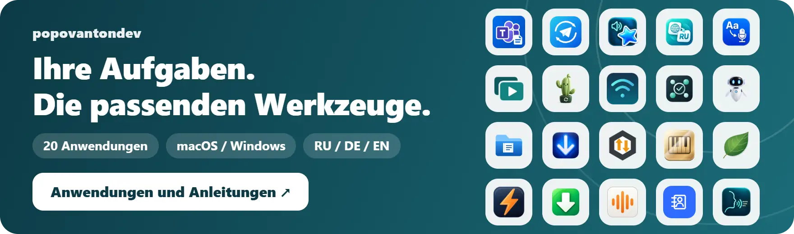</picture></a>

Ich entwickle Desktop-Anwendungen fürs Lernen, für Medien und für alltägliche Aufgaben unter macOS und Windows. Im Katalog stehen derzeit 20 Anwendungen.

**[→ Anwendungen und Anleitungen entdecken](https://popovantondev.github.io/popovantondev/index.html)**

## Gleich ausprobieren

<a href="https://popovantondev.github.io/PeakMP3/index.html#demo"><picture><source media="(prefers-color-scheme: dark)" srcset="https://raw.githubusercontent.com/popovantondev/popovantondev/main/docs/readme/demo-peakmp3-de-dark.7c835ea5.webp">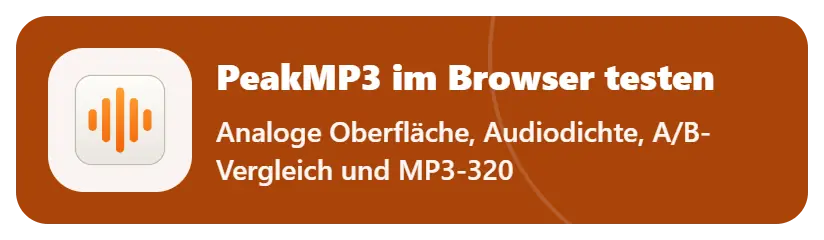</picture></a>
<a href="https://popovantondev.github.io/VirtualPianoArranger/play-de.html"><picture><source media="(prefers-color-scheme: dark)" srcset="https://raw.githubusercontent.com/popovantondev/popovantondev/main/docs/readme/demo-piano-de-dark.236ddd43.webp"></picture></a>

## Alle Anwendungen

### Lernen

<a href="https://popovantondev.github.io/SaveLecture/index.html"><picture><source media="(prefers-color-scheme: dark)" srcset="https://raw.githubusercontent.com/popovantondev/popovantondev/main/docs/readme/card-SaveLecture-de-dark.30aad83a.webp">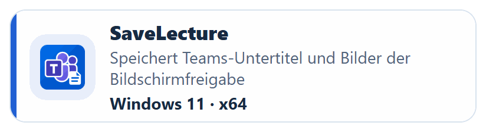</picture></a>
<a href="https://popovantondev.github.io/AnkiSound/index.html"><picture><source media="(prefers-color-scheme: dark)" srcset="https://raw.githubusercontent.com/popovantondev/popovantondev/main/docs/readme/card-AnkiSound-de-dark.97fdc5a4.webp">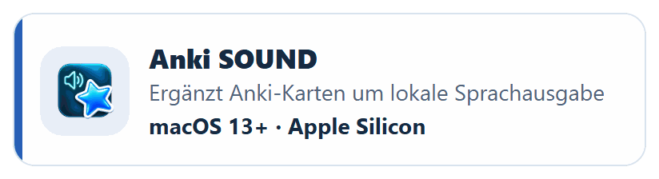</picture></a>
<a href="https://popovantondev.github.io/LectureTranslate/index.html"><picture><source media="(prefers-color-scheme: dark)" srcset="https://raw.githubusercontent.com/popovantondev/popovantondev/main/docs/readme/card-LectureTranslate-de-dark.d97a5570.webp"></picture></a>
<a href="https://popovantondev.github.io/LectureCompanion/index.html"><picture><source media="(prefers-color-scheme: dark)" srcset="https://raw.githubusercontent.com/popovantondev/popovantondev/main/docs/readme/card-LectureCompanion-de-dark.65123335.webp">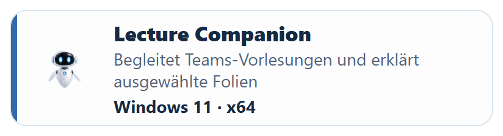</picture></a>
<a href="https://popovantondev.github.io/QuickAnswer/index.html"><picture><source media="(prefers-color-scheme: dark)" srcset="https://raw.githubusercontent.com/popovantondev/popovantondev/main/docs/readme/card-QuickAnswer-de-dark.921d9803.webp"></picture></a>
<a href="https://popovantondev.github.io/LektienPlayer/index.html"><picture><source media="(prefers-color-scheme: dark)" srcset="https://raw.githubusercontent.com/popovantondev/popovantondev/main/docs/readme/card-LektienPlayer-de-dark.6fda5798.webp"></picture></a>

### Medien

<a href="https://popovantondev.github.io/SRTtoSound/index.html"><picture><source media="(prefers-color-scheme: dark)" srcset="https://raw.githubusercontent.com/popovantondev/popovantondev/main/docs/readme/card-SRTtoSound-de-dark.2becdbba.webp">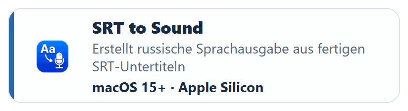</picture></a>
<a href="https://popovantondev.github.io/LectureMerge/index.html"><picture><source media="(prefers-color-scheme: dark)" srcset="https://raw.githubusercontent.com/popovantondev/popovantondev/main/docs/readme/card-LectureMerge-de-dark.ecbeb9cc.webp"></picture></a>
<a href="https://popovantondev.github.io/openmedia-downloader/index.html"><picture><source media="(prefers-color-scheme: dark)" srcset="https://raw.githubusercontent.com/popovantondev/popovantondev/main/docs/readme/card-openmedia-downloader-de-dark.f23bd6f6.webp">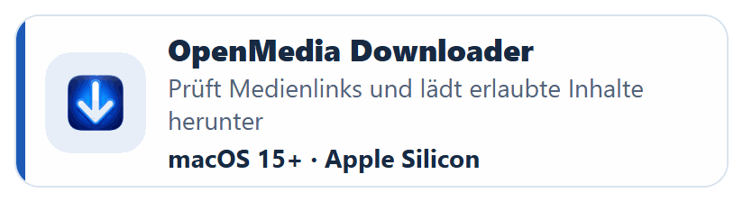</picture></a>
<a href="https://popovantondev.github.io/VirtualPianoArranger/index.html"><picture><source media="(prefers-color-scheme: dark)" srcset="https://raw.githubusercontent.com/popovantondev/popovantondev/main/docs/readme/card-VirtualPianoArranger-de-dark.ec4b35d6.webp"></picture></a>
<a href="https://popovantondev.github.io/SoundLeaf/index.html"><picture><source media="(prefers-color-scheme: dark)" srcset="https://raw.githubusercontent.com/popovantondev/popovantondev/main/docs/readme/card-SoundLeaf-de-dark.8fdaa12b.webp">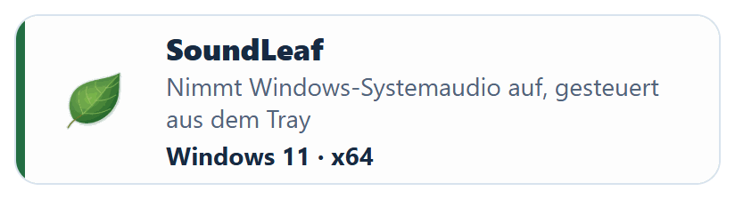</picture></a>
<a href="https://popovantondev.github.io/YouTubeDownloader/index.html"><picture><source media="(prefers-color-scheme: dark)" srcset="https://raw.githubusercontent.com/popovantondev/popovantondev/main/docs/readme/card-YouTubeDownloader-de-dark.2b5ca100.webp">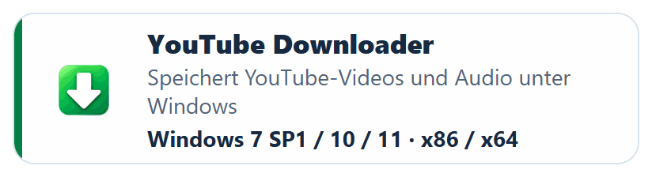</picture></a>
<a href="https://popovantondev.github.io/PeakMP3/index.html"><picture><source media="(prefers-color-scheme: dark)" srcset="https://raw.githubusercontent.com/popovantondev/popovantondev/main/docs/readme/card-PeakMP3-de-dark.6512fc8d.webp">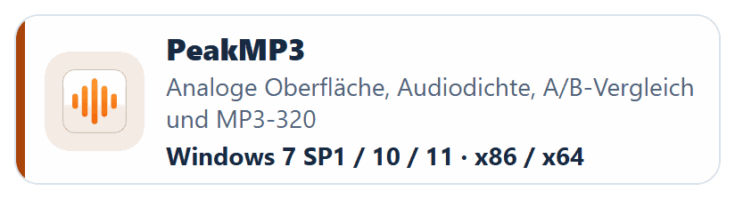</picture></a>

### Werkzeuge

<a href="https://popovantondev.github.io/TelegramMediaSender/index.html"><picture><source media="(prefers-color-scheme: dark)" srcset="https://raw.githubusercontent.com/popovantondev/popovantondev/main/docs/readme/card-TelegramMediaSender-de-dark.d98b487e.webp">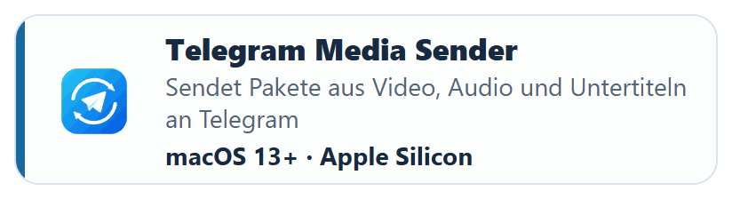</picture></a>
<a href="https://popovantondev.github.io/HotspotControl/index.html"><picture><source media="(prefers-color-scheme: dark)" srcset="https://raw.githubusercontent.com/popovantondev/popovantondev/main/docs/readme/card-HotspotControl-de-dark.a04c41a5.webp">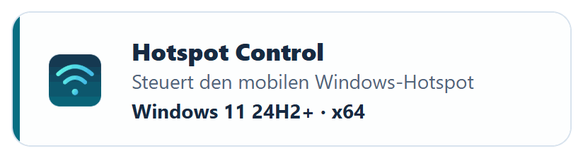</picture></a>
<a href="https://popovantondev.github.io/MegaProg/index.html"><picture><source media="(prefers-color-scheme: dark)" srcset="https://raw.githubusercontent.com/popovantondev/popovantondev/main/docs/readme/card-MegaProg-de-dark.d4fc75e9.webp">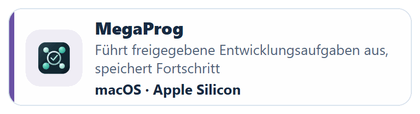</picture></a>

### Daten & Backup

<a href="https://popovantondev.github.io/Kaktus-Backup-Sync/index.html"><picture><source media="(prefers-color-scheme: dark)" srcset="https://raw.githubusercontent.com/popovantondev/popovantondev/main/docs/readme/card-Kaktus-Backup-Sync-de-dark.a3b5c5eb.webp">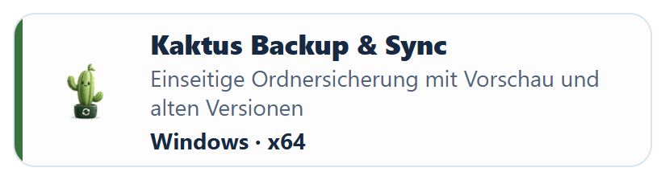</picture></a>
<a href="https://popovantondev.github.io/StudyArchivePrep/index.html"><picture><source media="(prefers-color-scheme: dark)" srcset="https://raw.githubusercontent.com/popovantondev/popovantondev/main/docs/readme/card-StudyArchivePrep-de-dark.66e03cc0.webp">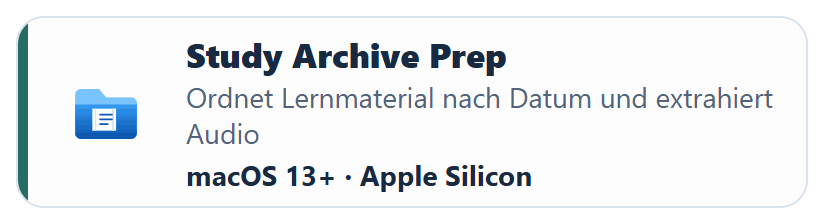</picture></a>
<a href="https://popovantondev.github.io/GitHubSync/index.html"><picture><source media="(prefers-color-scheme: dark)" srcset="https://raw.githubusercontent.com/popovantondev/popovantondev/main/docs/readme/card-GitHubSync-de-dark.59b2c48f.webp"></picture></a>
<a href="https://popovantondev.github.io/Kartoteka/index.html"><picture><source media="(prefers-color-scheme: dark)" srcset="https://raw.githubusercontent.com/popovantondev/popovantondev/main/docs/readme/card-Kartoteka-de-dark.6dfc6cea.webp"></picture></a>

Links zu Download, Anleitung und Fehlermeldung

| Programme | Plattform / Status | Links |
|---|---|---|
| [SaveLecture](https://popovantondev.github.io/SaveLecture/index.html) | Windows 11 · x64 Vorabversion 0.1.0-preview.4 | [Herunterladen](https://github.com/popovantondev/SaveLecture/releases/tag/v0.1.0-preview.4) · [Quellcode](https://github.com/popovantondev/SaveLecture) · [Anleitung](https://popovantondev.github.io/SaveLecture/Guide-de.html) · [Fehler melden](https://github.com/popovantondev/SaveLecture/issues/new) |
| [Telegram Media Sender](https://popovantondev.github.io/TelegramMediaSender/index.html) | macOS 13+ · Apple Silicon Release 1.1.2 | [Herunterladen](https://github.com/popovantondev/TelegramMediaSender/releases/tag/v1.1.2) · [Quellcode](https://github.com/popovantondev/TelegramMediaSender) · [Anleitung](https://popovantondev.github.io/TelegramMediaSender/Guide-de.html) · [Fehler melden](https://github.com/popovantondev/TelegramMediaSender/issues/new/choose) |
| [Anki SOUND](https://popovantondev.github.io/AnkiSound/index.html) | macOS 13+ · Apple Silicon Release 3.4.11 | [Herunterladen](https://github.com/popovantondev/AnkiSound/releases/tag/v3.4.11) · [Quellcode](https://github.com/popovantondev/AnkiSound) · [Anleitung](https://popovantondev.github.io/AnkiSound/Guide-de.html) · [Fehler melden](https://github.com/popovantondev/AnkiSound/issues/new/choose) |
| [LectureTranslate](https://popovantondev.github.io/LectureTranslate/index.html) | macOS 15+ · Apple Silicon Release 3.5.1 | [Herunterladen](https://github.com/popovantondev/LectureTranslate/releases/tag/v3.5.1) · [Quellcode](https://github.com/popovantondev/LectureTranslate) · [Anleitung](https://popovantondev.github.io/LectureTranslate/Guide-de.html) · [Fehler melden](https://github.com/popovantondev/LectureTranslate/issues/new/choose) |
| [SRT to Sound](https://popovantondev.github.io/SRTtoSound/index.html) | macOS 15+ · Apple Silicon Release 3.5.0 | [Herunterladen](https://github.com/popovantondev/SRTtoSound/releases/tag/v3.5.0) · [Quellcode](https://github.com/popovantondev/SRTtoSound) · [Anleitung](https://popovantondev.github.io/SRTtoSound/Guide-de.html) · [Fehler melden](https://github.com/popovantondev/SRTtoSound/issues/new/choose) |
| [LectureMerge](https://popovantondev.github.io/LectureMerge/index.html) | macOS 14+ · Apple Silicon Release 2.2.0 | [Herunterladen](https://github.com/popovantondev/LectureMerge/releases/tag/v2.2.0) · [Quellcode](https://github.com/popovantondev/LectureMerge) · [Anleitung](https://popovantondev.github.io/LectureMerge/Guide-de.html) · [Fehler melden](https://github.com/popovantondev/LectureMerge/issues/new/choose) |
| [Kaktus Backup & Sync](https://popovantondev.github.io/Kaktus-Backup-Sync/index.html) | Windows · x64 Vorabversion 5.2.0-preview.7 | [Herunterladen](https://github.com/popovantondev/Kaktus-Backup-Sync/releases/tag/v5.2.0-preview.7) · [Quellcode](https://github.com/popovantondev/Kaktus-Backup-Sync) · [Anleitung](https://popovantondev.github.io/Kaktus-Backup-Sync/Guide-de.html) · [Fehler melden](https://github.com/popovantondev/Kaktus-Backup-Sync/issues/new/choose) |
| [Hotspot Control](https://popovantondev.github.io/HotspotControl/index.html) | Windows 11 24H2+ · x64 Release 0.3.0 | [Herunterladen](https://github.com/popovantondev/HotspotControl/releases/tag/v0.3.0) · [Quellcode](https://github.com/popovantondev/HotspotControl) · [Anleitung](https://popovantondev.github.io/HotspotControl/Guide-de.html) · [Fehler melden](https://github.com/popovantondev/HotspotControl/issues/new/choose) |
| [MegaProg](https://popovantondev.github.io/MegaProg/index.html) | macOS · Apple Silicon Vorabversion 4.5.1 | [Herunterladen](https://github.com/popovantondev/MegaProg/releases/tag/v4.5.1-preview.1) · [Quellcode](https://github.com/popovantondev/MegaProg) · [Anleitung](https://popovantondev.github.io/MegaProg/Guide-de.html) · [Fehler melden](https://github.com/popovantondev/MegaProg/issues/new/choose) |
| [Lecture Companion](https://popovantondev.github.io/LectureCompanion/index.html) | Windows 11 · x64 Vorabversion 2.4 | [Herunterladen](https://github.com/popovantondev/LectureCompanion/releases/tag/v2.4) · [Quellcode](https://github.com/popovantondev/LectureCompanion) · [Anleitung](https://popovantondev.github.io/LectureCompanion/Guide-de.html) · [Fehler melden](https://github.com/popovantondev/LectureCompanion/issues/new/choose) |
| [Study Archive Prep](https://popovantondev.github.io/StudyArchivePrep/index.html) | macOS 13+ · Apple Silicon Nur Quellcode 0.1.0 | [Quellcode](https://github.com/popovantondev/StudyArchivePrep) · [Anleitung](https://popovantondev.github.io/StudyArchivePrep/Guide-de.html) · [Fehler melden](https://github.com/popovantondev/StudyArchivePrep/issues/new/choose) |
| [OpenMedia Downloader](https://popovantondev.github.io/openmedia-downloader/index.html) | macOS 15+ · Apple Silicon Nur Quellcode 5.5.0 | [Quellcode](https://github.com/popovantondev/openmedia-downloader) · [Anleitung](https://popovantondev.github.io/openmedia-downloader/Guide-de.html) · [Fehler melden](https://github.com/popovantondev/openmedia-downloader/issues/new/choose) |
| [GitHubSync](https://popovantondev.github.io/GitHubSync/index.html) | Windows 10/11 · x64 Release 1.5.3 | [Herunterladen](https://github.com/popovantondev/GitHubSync/releases/tag/v1.5.3) · [Quellcode](https://github.com/popovantondev/GitHubSync) · [Anleitung](https://popovantondev.github.io/GitHubSync/Guide-de.html) · [Fehler melden](https://github.com/popovantondev/GitHubSync/issues/new/choose) |
| [Virtual Piano Arranger](https://popovantondev.github.io/VirtualPianoArranger/index.html) | Windows · x64 Vorabversion 0.1.0-preview.1 | [Herunterladen](https://github.com/popovantondev/VirtualPianoArranger/releases/tag/v0.1.0-preview.1) · [Quellcode](https://github.com/popovantondev/VirtualPianoArranger) · [Anleitung](https://popovantondev.github.io/VirtualPianoArranger/Guide-de.html) · [Im Browser spielen](https://popovantondev.github.io/VirtualPianoArranger/play-de.html) · [Fehler melden](https://github.com/popovantondev/VirtualPianoArranger/issues/new) |
| [SoundLeaf](https://popovantondev.github.io/SoundLeaf/index.html) | Windows 11 · x64 Vorabversion 3.0.5 | [Herunterladen](https://github.com/popovantondev/SoundLeaf/releases/tag/v3.0.5) · [Quellcode](https://github.com/popovantondev/SoundLeaf) · [Anleitung](https://popovantondev.github.io/SoundLeaf/Guide-de.html) · [Fehler melden](https://github.com/popovantondev/SoundLeaf/issues/new/choose) |
| [Quick Answer](https://popovantondev.github.io/QuickAnswer/index.html) | Microsoft Edge · Windows Nur Quellcode 1.7.8 | [Quellcode](https://github.com/popovantondev/QuickAnswer) · [Anleitung](https://popovantondev.github.io/QuickAnswer/Guide-de.html) · [Fehler melden](https://github.com/popovantondev/QuickAnswer/issues/new) |
| [YouTube Downloader](https://popovantondev.github.io/YouTubeDownloader/index.html) | Windows 7 SP1 / 10 / 11 · x86 / x64 Vorabversion 2.6.0 | [Herunterladen](https://github.com/popovantondev/YouTubeDownloader/releases/tag/v2.6.0) · [Quellcode](https://github.com/popovantondev/YouTubeDownloader) · [Anleitung](https://popovantondev.github.io/YouTubeDownloader/Guide-de.html) · [Fehler melden](https://github.com/popovantondev/YouTubeDownloader/issues/new/choose) |
| [PeakMP3](https://popovantondev.github.io/PeakMP3/index.html) | Windows 7 SP1 / 10 / 11 · x86 / x64 Vorabversion 0.16.0 | [Herunterladen](https://github.com/popovantondev/YouTubeDownloader/releases/tag/v2.6.0) · [Quellcode](https://github.com/popovantondev/PeakMP3) · [Anleitung](https://popovantondev.github.io/PeakMP3/Guide-de.html) · [Im Browser testen](https://popovantondev.github.io/PeakMP3/index.html#demo) · [Fehler melden](https://github.com/popovantondev/PeakMP3/issues/new) |
| [Kartoteka](https://popovantondev.github.io/Kartoteka/index.html) | Windows 11 · x64 Release 0.5.0 | [Herunterladen](https://github.com/popovantondev/Kartoteka/releases/tag/v0.5.0) · [Quellcode](https://github.com/popovantondev/Kartoteka) · [Anleitung](https://popovantondev.github.io/Kartoteka/Guide-de.html) · [Fehler melden](https://github.com/popovantondev/Kartoteka/issues/new) |
| [Lektien Player](https://popovantondev.github.io/LektienPlayer/index.html) | macOS 15+ · Apple Silicon Nur Quellcode | [Quellcode](https://github.com/popovantondev/LektienPlayer) · [Anleitung](https://popovantondev.github.io/LektienPlayer/Guide-de.html) · [Fehler melden](https://github.com/popovantondev/LektienPlayer/issues/new) |

*PeakMP3 wird im Installationspaket von YouTube Downloader ausgeliefert; der Download-Link von PeakMP3 führt deshalb zum Release von YouTube Downloader.*

## Oberflächen ansehen

[SaveLecture](https://raw.githubusercontent.com/popovantondev/SaveLecture/main/docs/readme/preview-de-light.a5938a6d.webp) · [Telegram Media Sender](https://raw.githubusercontent.com/popovantondev/TelegramMediaSender/main/docs/readme/preview-de-light.6451fd9c.webp) · [Anki SOUND](https://raw.githubusercontent.com/popovantondev/AnkiSound/main/docs/readme/preview-de-light.c637d744.webp) · [LectureTranslate](https://raw.githubusercontent.com/popovantondev/LectureTranslate/main/docs/readme/preview-de-light.dc8bea81.webp) · [SRT to Sound](https://raw.githubusercontent.com/popovantondev/SRTtoSound/main/docs/readme/preview-de-light.a432e836.webp) · [LectureMerge](https://raw.githubusercontent.com/popovantondev/LectureMerge/main/docs/readme/preview-de-light.2dbff149.webp) · [Kaktus Backup & Sync](https://raw.githubusercontent.com/popovantondev/Kaktus-Backup-Sync/main/docs/readme/preview-de-light.234df61d.webp) · [Hotspot Control](https://raw.githubusercontent.com/popovantondev/HotspotControl/main/docs/readme/preview-de-light.65b49a94.webp) · [MegaProg](https://raw.githubusercontent.com/popovantondev/MegaProg/main/docs/readme/preview-de-light.28f4fbc7.webp) · [Lecture Companion](https://raw.githubusercontent.com/popovantondev/LectureCompanion/main/docs/readme/preview-de-light.f2d08a5c.webp) · [Study Archive Prep](https://raw.githubusercontent.com/popovantondev/StudyArchivePrep/main/docs/readme/preview-de-light.db550553.webp) · [OpenMedia Downloader](https://raw.githubusercontent.com/popovantondev/openmedia-downloader/main/docs/readme/preview-de-light.ae32ac81.webp) · [GitHubSync](https://raw.githubusercontent.com/popovantondev/GitHubSync/main/docs/readme/preview-de-light.566fa841.webp) · [Virtual Piano Arranger](https://raw.githubusercontent.com/popovantondev/VirtualPianoArranger/main/docs/readme/preview-de-light.dca3437e.webp) · [SoundLeaf](https://raw.githubusercontent.com/popovantondev/SoundLeaf/main/docs/readme/preview-de-light.45be2a94.webp) · [Quick Answer](https://raw.githubusercontent.com/popovantondev/QuickAnswer/main/docs/readme/preview-de-light.a7b68f29.webp) · [YouTube Downloader](https://raw.githubusercontent.com/popovantondev/YouTubeDownloader/main/docs/readme/preview-de-light.609853f7.webp) · [PeakMP3](https://raw.githubusercontent.com/popovantondev/PeakMP3/main/docs/readme/preview-de-light.3d844bca.webp) · [Kartoteka](https://raw.githubusercontent.com/popovantondev/Kartoteka/main/docs/readme/preview-de-light.471a9b15.webp) · [Lektien Player](https://raw.githubusercontent.com/popovantondev/LektienPlayer/main/docs/readme/preview-de-light.6877968c.webp)

## Downloads und Hilfe

Die Anleitung jeder Anwendung enthält Voraussetzungen und erste Schritte. Laden Sie die Anwendung aus Releases herunter, nicht das Quellcode-ZIP. Preview-Versionen werden noch entwickelt; Projekte mit dem Status „Nur Quellcode“ haben kein fertiges Installationspaket.

Für Fragen oder Fehlerberichte nutzen Sie „Fehler melden“ in der Zeile der Anwendung. Geben Sie die Programmversion, das Betriebssystem und die Schritte zum Nachstellen an.

### Technologien

C# · Python · Swift · WPF · PySide6 · .NET · [JavaScript — Quick Answer](https://popovantondev.github.io/QuickAnswer/index.html) · SwiftUI · Ruby · AppKit · PowerShell · Rust · egui · SQLite

Vor der Nutzung die Anleitung und Release-Hinweise lesen.
