
<a href="README.ru.md">Русский</a> · <a href="README.md">Deutsch</a> · <a href="README.en.md">English</a>

<a href="https://popovantondev.github.io/popovantondev/index-ru.html"><picture><source media="(prefers-color-scheme: dark)" srcset="https://raw.githubusercontent.com/popovantondev/popovantondev/main/docs/readme/banner-ru-dark.16e1a8d5.webp"></picture></a>

Разрабатываю приложения для учёбы, работы с медиа и повседневных задач на macOS и Windows. В каталоге сейчас 20 приложений.

**[→ Каталог программ и руководств](https://popovantondev.github.io/popovantondev/index-ru.html)**

## Попробовать сразу

<a href="https://popovantondev.github.io/PeakMP3/index-ru.html#demo"><picture><source media="(prefers-color-scheme: dark)" srcset="https://raw.githubusercontent.com/popovantondev/popovantondev/main/docs/readme/demo-peakmp3-ru-dark.74ccff95.webp">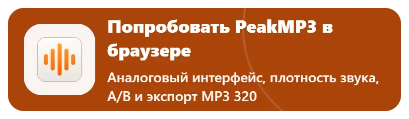</picture></a>
<a href="https://popovantondev.github.io/VirtualPianoArranger/play-ru.html"><picture><source media="(prefers-color-scheme: dark)" srcset="https://raw.githubusercontent.com/popovantondev/popovantondev/main/docs/readme/demo-piano-ru-dark.836d135b.webp"></picture></a>

## Все программы

### Учёба

<a href="https://popovantondev.github.io/SaveLecture/index-ru.html"><picture><source media="(prefers-color-scheme: dark)" srcset="https://raw.githubusercontent.com/popovantondev/popovantondev/main/docs/readme/card-SaveLecture-ru-dark.a53d6939.webp">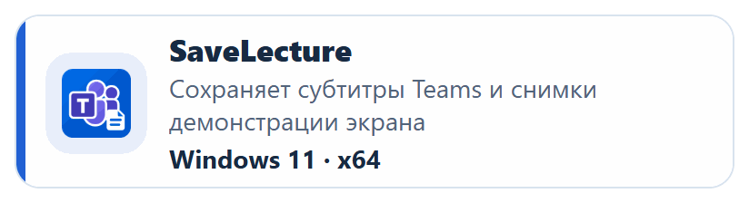</picture></a>
<a href="https://popovantondev.github.io/AnkiSound/index-ru.html"><picture><source media="(prefers-color-scheme: dark)" srcset="https://raw.githubusercontent.com/popovantondev/popovantondev/main/docs/readme/card-AnkiSound-ru-dark.1c1385e6.webp">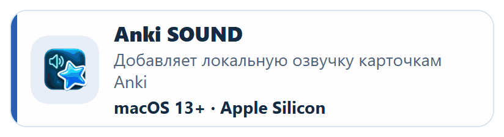</picture></a>
<a href="https://popovantondev.github.io/LectureTranslate/index-ru.html"><picture><source media="(prefers-color-scheme: dark)" srcset="https://raw.githubusercontent.com/popovantondev/popovantondev/main/docs/readme/card-LectureTranslate-ru-dark.d3328694.webp">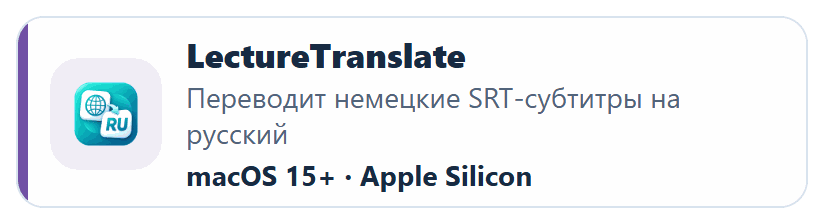</picture></a>
<a href="https://popovantondev.github.io/LectureCompanion/index-ru.html"><picture><source media="(prefers-color-scheme: dark)" srcset="https://raw.githubusercontent.com/popovantondev/popovantondev/main/docs/readme/card-LectureCompanion-ru-dark.cae4c0a1.webp">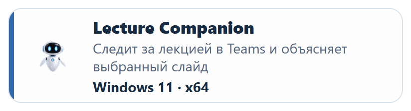</picture></a>
<a href="https://popovantondev.github.io/QuickAnswer/index-ru.html"><picture><source media="(prefers-color-scheme: dark)" srcset="https://raw.githubusercontent.com/popovantondev/popovantondev/main/docs/readme/card-QuickAnswer-ru-dark.ea887067.webp"></picture></a>
<a href="https://popovantondev.github.io/LektienPlayer/index-ru.html"><picture><source media="(prefers-color-scheme: dark)" srcset="https://raw.githubusercontent.com/popovantondev/popovantondev/main/docs/readme/card-LektienPlayer-ru-dark.f55140ab.webp">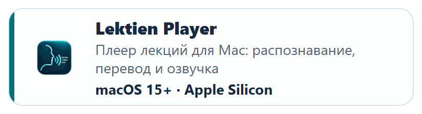</picture></a>

### Медиа

<a href="https://popovantondev.github.io/SRTtoSound/index-ru.html"><picture><source media="(prefers-color-scheme: dark)" srcset="https://raw.githubusercontent.com/popovantondev/popovantondev/main/docs/readme/card-SRTtoSound-ru-dark.6b02dec6.webp">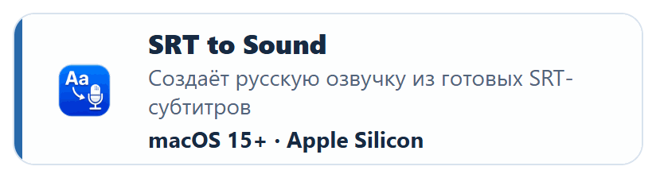</picture></a>
<a href="https://popovantondev.github.io/LectureMerge/index-ru.html"><picture><source media="(prefers-color-scheme: dark)" srcset="https://raw.githubusercontent.com/popovantondev/popovantondev/main/docs/readme/card-LectureMerge-ru-dark.f3c4e5a7.webp">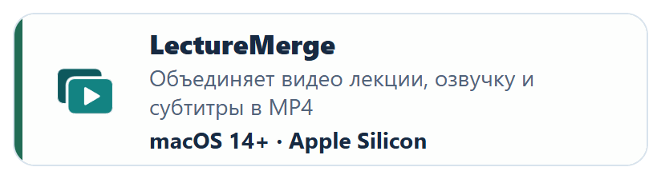</picture></a>
<a href="https://popovantondev.github.io/openmedia-downloader/index-ru.html"><picture><source media="(prefers-color-scheme: dark)" srcset="https://raw.githubusercontent.com/popovantondev/popovantondev/main/docs/readme/card-openmedia-downloader-ru-dark.30fabdb4.webp">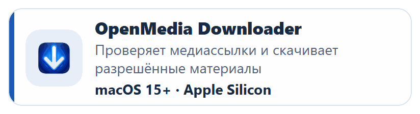</picture></a>
<a href="https://popovantondev.github.io/VirtualPianoArranger/index-ru.html"><picture><source media="(prefers-color-scheme: dark)" srcset="https://raw.githubusercontent.com/popovantondev/popovantondev/main/docs/readme/card-VirtualPianoArranger-ru-dark.328276fc.webp"></picture></a>
<a href="https://popovantondev.github.io/SoundLeaf/index-ru.html"><picture><source media="(prefers-color-scheme: dark)" srcset="https://raw.githubusercontent.com/popovantondev/popovantondev/main/docs/readme/card-SoundLeaf-ru-dark.185b0722.webp">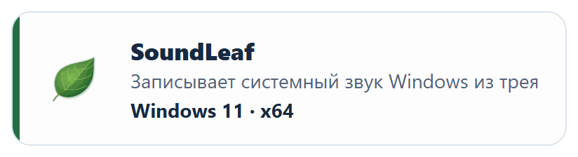</picture></a>
<a href="https://popovantondev.github.io/YouTubeDownloader/index-ru.html"><picture><source media="(prefers-color-scheme: dark)" srcset="https://raw.githubusercontent.com/popovantondev/popovantondev/main/docs/readme/card-YouTubeDownloader-ru-dark.733f1ab9.webp"></picture></a>
<a href="https://popovantondev.github.io/PeakMP3/index-ru.html"><picture><source media="(prefers-color-scheme: dark)" srcset="https://raw.githubusercontent.com/popovantondev/popovantondev/main/docs/readme/card-PeakMP3-ru-dark.0601ec95.webp">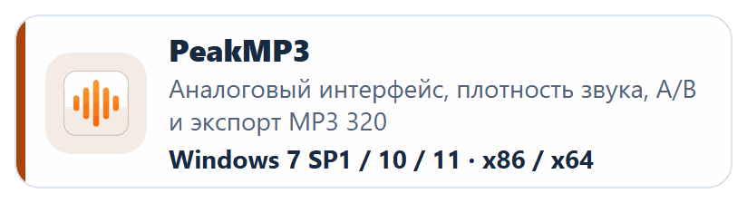</picture></a>

### Инструменты

<a href="https://popovantondev.github.io/TelegramMediaSender/index-ru.html"><picture><source media="(prefers-color-scheme: dark)" srcset="https://raw.githubusercontent.com/popovantondev/popovantondev/main/docs/readme/card-TelegramMediaSender-ru-dark.2f9c8ffb.webp">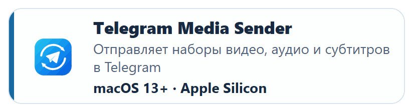</picture></a>
<a href="https://popovantondev.github.io/HotspotControl/index-ru.html"><picture><source media="(prefers-color-scheme: dark)" srcset="https://raw.githubusercontent.com/popovantondev/popovantondev/main/docs/readme/card-HotspotControl-ru-dark.a268656a.webp">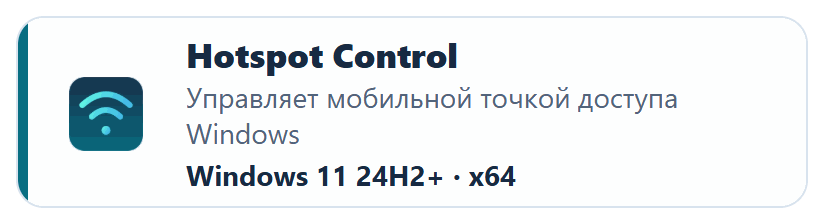</picture></a>
<a href="https://popovantondev.github.io/MegaProg/index-ru.html"><picture><source media="(prefers-color-scheme: dark)" srcset="https://raw.githubusercontent.com/popovantondev/popovantondev/main/docs/readme/card-MegaProg-ru-dark.0fa54b08.webp">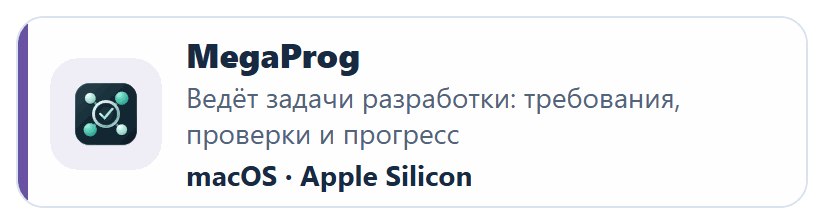</picture></a>

### Данные и бэкап

<a href="https://popovantondev.github.io/Kaktus-Backup-Sync/index-ru.html"><picture><source media="(prefers-color-scheme: dark)" srcset="https://raw.githubusercontent.com/popovantondev/popovantondev/main/docs/readme/card-Kaktus-Backup-Sync-ru-dark.2a957090.webp">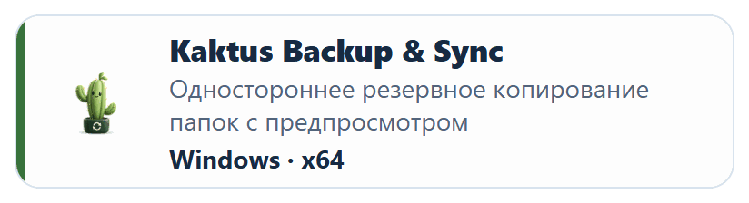</picture></a>
<a href="https://popovantondev.github.io/StudyArchivePrep/index-ru.html"><picture><source media="(prefers-color-scheme: dark)" srcset="https://raw.githubusercontent.com/popovantondev/popovantondev/main/docs/readme/card-StudyArchivePrep-ru-dark.26770a38.webp">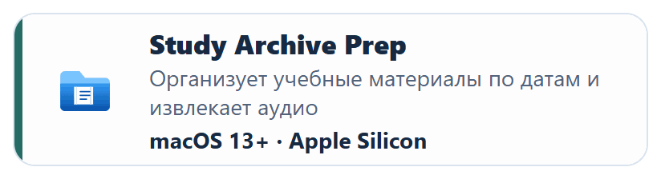</picture></a>
<a href="https://popovantondev.github.io/GitHubSync/index-ru.html"><picture><source media="(prefers-color-scheme: dark)" srcset="https://raw.githubusercontent.com/popovantondev/popovantondev/main/docs/readme/card-GitHubSync-ru-dark.c8e183c8.webp"></picture></a>
<a href="https://popovantondev.github.io/Kartoteka/index-ru.html"><picture><source media="(prefers-color-scheme: dark)" srcset="https://raw.githubusercontent.com/popovantondev/popovantondev/main/docs/readme/card-Kartoteka-ru-dark.f430890b.webp">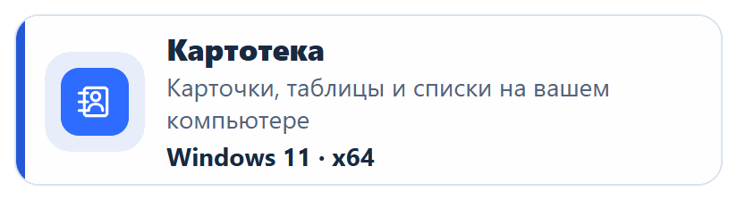</picture></a>

Ссылки на загрузку, инструкции и сообщения об ошибках

| Программы | Платформа / Статус | Ссылки |
|---|---|---|
| [SaveLecture](https://popovantondev.github.io/SaveLecture/index-ru.html) | Windows 11 · x64 Предварительный выпуск 0.1.0-preview.4 | [Скачать](https://github.com/popovantondev/SaveLecture/releases/tag/v0.1.0-preview.4) · [Исходники](https://github.com/popovantondev/SaveLecture) · [Инструкция](https://popovantondev.github.io/SaveLecture/Guide-ru.html) · [Сообщить об ошибке](https://github.com/popovantondev/SaveLecture/issues/new) |
| [Telegram Media Sender](https://popovantondev.github.io/TelegramMediaSender/index-ru.html) | macOS 13+ · Apple Silicon Выпуск 1.1.2 | [Скачать](https://github.com/popovantondev/TelegramMediaSender/releases/tag/v1.1.2) · [Исходники](https://github.com/popovantondev/TelegramMediaSender) · [Инструкция](https://popovantondev.github.io/TelegramMediaSender/Guide-ru.html) · [Сообщить об ошибке](https://github.com/popovantondev/TelegramMediaSender/issues/new/choose) |
| [Anki SOUND](https://popovantondev.github.io/AnkiSound/index-ru.html) | macOS 13+ · Apple Silicon Выпуск 3.4.11 | [Скачать](https://github.com/popovantondev/AnkiSound/releases/tag/v3.4.11) · [Исходники](https://github.com/popovantondev/AnkiSound) · [Инструкция](https://popovantondev.github.io/AnkiSound/Guide-ru.html) · [Сообщить об ошибке](https://github.com/popovantondev/AnkiSound/issues/new/choose) |
| [LectureTranslate](https://popovantondev.github.io/LectureTranslate/index-ru.html) | macOS 15+ · Apple Silicon Выпуск 3.5.1 | [Скачать](https://github.com/popovantondev/LectureTranslate/releases/tag/v3.5.1) · [Исходники](https://github.com/popovantondev/LectureTranslate) · [Инструкция](https://popovantondev.github.io/LectureTranslate/Guide-ru.html) · [Сообщить об ошибке](https://github.com/popovantondev/LectureTranslate/issues/new/choose) |
| [SRT to Sound](https://popovantondev.github.io/SRTtoSound/index-ru.html) | macOS 15+ · Apple Silicon Выпуск 3.5.0 | [Скачать](https://github.com/popovantondev/SRTtoSound/releases/tag/v3.5.0) · [Исходники](https://github.com/popovantondev/SRTtoSound) · [Инструкция](https://popovantondev.github.io/SRTtoSound/Guide-ru.html) · [Сообщить об ошибке](https://github.com/popovantondev/SRTtoSound/issues/new/choose) |
| [LectureMerge](https://popovantondev.github.io/LectureMerge/index-ru.html) | macOS 14+ · Apple Silicon Выпуск 2.2.0 | [Скачать](https://github.com/popovantondev/LectureMerge/releases/tag/v2.2.0) · [Исходники](https://github.com/popovantondev/LectureMerge) · [Инструкция](https://popovantondev.github.io/LectureMerge/Guide-ru.html) · [Сообщить об ошибке](https://github.com/popovantondev/LectureMerge/issues/new/choose) |
| [Kaktus Backup & Sync](https://popovantondev.github.io/Kaktus-Backup-Sync/index-ru.html) | Windows · x64 Предварительный выпуск 5.2.0-preview.7 | [Скачать](https://github.com/popovantondev/Kaktus-Backup-Sync/releases/tag/v5.2.0-preview.7) · [Исходники](https://github.com/popovantondev/Kaktus-Backup-Sync) · [Инструкция](https://popovantondev.github.io/Kaktus-Backup-Sync/Guide-ru.html) · [Сообщить об ошибке](https://github.com/popovantondev/Kaktus-Backup-Sync/issues/new/choose) |
| [Hotspot Control](https://popovantondev.github.io/HotspotControl/index-ru.html) | Windows 11 24H2+ · x64 Выпуск 0.3.0 | [Скачать](https://github.com/popovantondev/HotspotControl/releases/tag/v0.3.0) · [Исходники](https://github.com/popovantondev/HotspotControl) · [Инструкция](https://popovantondev.github.io/HotspotControl/Guide-ru.html) · [Сообщить об ошибке](https://github.com/popovantondev/HotspotControl/issues/new/choose) |
| [MegaProg](https://popovantondev.github.io/MegaProg/index-ru.html) | macOS · Apple Silicon Предварительный выпуск 4.5.1 | [Скачать](https://github.com/popovantondev/MegaProg/releases/tag/v4.5.1-preview.1) · [Исходники](https://github.com/popovantondev/MegaProg) · [Инструкция](https://popovantondev.github.io/MegaProg/Guide-ru.html) · [Сообщить об ошибке](https://github.com/popovantondev/MegaProg/issues/new/choose) |
| [Lecture Companion](https://popovantondev.github.io/LectureCompanion/index-ru.html) | Windows 11 · x64 Предварительный выпуск 2.4 | [Скачать](https://github.com/popovantondev/LectureCompanion/releases/tag/v2.4) · [Исходники](https://github.com/popovantondev/LectureCompanion) · [Инструкция](https://popovantondev.github.io/LectureCompanion/Guide-ru.html) · [Сообщить об ошибке](https://github.com/popovantondev/LectureCompanion/issues/new/choose) |
| [Study Archive Prep](https://popovantondev.github.io/StudyArchivePrep/index-ru.html) | macOS 13+ · Apple Silicon Только исходники 0.1.0 | [Исходники](https://github.com/popovantondev/StudyArchivePrep) · [Инструкция](https://popovantondev.github.io/StudyArchivePrep/Guide-ru.html) · [Сообщить об ошибке](https://github.com/popovantondev/StudyArchivePrep/issues/new/choose) |
| [OpenMedia Downloader](https://popovantondev.github.io/openmedia-downloader/index-ru.html) | macOS 15+ · Apple Silicon Только исходники 5.5.0 | [Исходники](https://github.com/popovantondev/openmedia-downloader) · [Инструкция](https://popovantondev.github.io/openmedia-downloader/Guide-ru.html) · [Сообщить об ошибке](https://github.com/popovantondev/openmedia-downloader/issues/new/choose) |
| [GitHubSync](https://popovantondev.github.io/GitHubSync/index-ru.html) | Windows 10/11 · x64 Выпуск 1.5.3 | [Скачать](https://github.com/popovantondev/GitHubSync/releases/tag/v1.5.3) · [Исходники](https://github.com/popovantondev/GitHubSync) · [Инструкция](https://popovantondev.github.io/GitHubSync/Guide-ru.html) · [Сообщить об ошибке](https://github.com/popovantondev/GitHubSync/issues/new/choose) |
| [Virtual Piano Arranger](https://popovantondev.github.io/VirtualPianoArranger/index-ru.html) | Windows · x64 Предварительный выпуск 0.1.0-preview.1 | [Скачать](https://github.com/popovantondev/VirtualPianoArranger/releases/tag/v0.1.0-preview.1) · [Исходники](https://github.com/popovantondev/VirtualPianoArranger) · [Инструкция](https://popovantondev.github.io/VirtualPianoArranger/Guide-ru.html) · [Играть в браузере](https://popovantondev.github.io/VirtualPianoArranger/play-ru.html) · [Сообщить об ошибке](https://github.com/popovantondev/VirtualPianoArranger/issues/new) |
| [SoundLeaf](https://popovantondev.github.io/SoundLeaf/index-ru.html) | Windows 11 · x64 Предварительный выпуск 3.0.5 | [Скачать](https://github.com/popovantondev/SoundLeaf/releases/tag/v3.0.5) · [Исходники](https://github.com/popovantondev/SoundLeaf) · [Инструкция](https://popovantondev.github.io/SoundLeaf/Guide-ru.html) · [Сообщить об ошибке](https://github.com/popovantondev/SoundLeaf/issues/new/choose) |
| [Quick Answer](https://popovantondev.github.io/QuickAnswer/index-ru.html) | Microsoft Edge · Windows Только исходники 1.7.8 | [Исходники](https://github.com/popovantondev/QuickAnswer) · [Инструкция](https://popovantondev.github.io/QuickAnswer/Guide-ru.html) · [Сообщить об ошибке](https://github.com/popovantondev/QuickAnswer/issues/new) |
| [YouTube Downloader](https://popovantondev.github.io/YouTubeDownloader/index-ru.html) | Windows 7 SP1 / 10 / 11 · x86 / x64 Предварительный выпуск 2.6.0 | [Скачать](https://github.com/popovantondev/YouTubeDownloader/releases/tag/v2.6.0) · [Исходники](https://github.com/popovantondev/YouTubeDownloader) · [Инструкция](https://popovantondev.github.io/YouTubeDownloader/Guide-ru.html) · [Сообщить об ошибке](https://github.com/popovantondev/YouTubeDownloader/issues/new/choose) |
| [PeakMP3](https://popovantondev.github.io/PeakMP3/index-ru.html) | Windows 7 SP1 / 10 / 11 · x86 / x64 Предварительный выпуск 0.16.0 | [Скачать](https://github.com/popovantondev/YouTubeDownloader/releases/tag/v2.6.0) · [Исходники](https://github.com/popovantondev/PeakMP3) · [Инструкция](https://popovantondev.github.io/PeakMP3/Guide-ru.html) · [Попробовать в браузере](https://popovantondev.github.io/PeakMP3/index-ru.html#demo) · [Сообщить об ошибке](https://github.com/popovantondev/PeakMP3/issues/new) |
| [Kartoteka](https://popovantondev.github.io/Kartoteka/index-ru.html) | Windows 11 · x64 Выпуск 0.5.0 | [Скачать](https://github.com/popovantondev/Kartoteka/releases/tag/v0.5.0) · [Исходники](https://github.com/popovantondev/Kartoteka) · [Инструкция](https://popovantondev.github.io/Kartoteka/Guide-ru.html) · [Сообщить об ошибке](https://github.com/popovantondev/Kartoteka/issues/new) |
| [Lektien Player](https://popovantondev.github.io/LektienPlayer/index-ru.html) | macOS 15+ · Apple Silicon Только исходники | [Исходники](https://github.com/popovantondev/LektienPlayer) · [Инструкция](https://popovantondev.github.io/LektienPlayer/Guide-ru.html) · [Сообщить об ошибке](https://github.com/popovantondev/LektienPlayer/issues/new) |

*PeakMP3 входит в установочный пакет YouTube Downloader, поэтому ссылка «Скачать» у PeakMP3 ведёт на релиз YouTube Downloader.*

## Посмотреть интерфейсы

[SaveLecture](https://raw.githubusercontent.com/popovantondev/SaveLecture/main/docs/readme/preview-ru-light.c67006b6.webp) · [Telegram Media Sender](https://raw.githubusercontent.com/popovantondev/TelegramMediaSender/main/docs/readme/preview-ru-light.7070ffa6.webp) · [Anki SOUND](https://raw.githubusercontent.com/popovantondev/AnkiSound/main/docs/readme/preview-ru-light.3b70a2ac.webp) · [LectureTranslate](https://raw.githubusercontent.com/popovantondev/LectureTranslate/main/docs/readme/preview-ru-light.bd004472.webp) · [SRT to Sound](https://raw.githubusercontent.com/popovantondev/SRTtoSound/main/docs/readme/preview-ru-light.6a308467.webp) · [LectureMerge](https://raw.githubusercontent.com/popovantondev/LectureMerge/main/docs/readme/preview-ru-light.e4bca2a6.webp) · [Kaktus Backup & Sync](https://raw.githubusercontent.com/popovantondev/Kaktus-Backup-Sync/main/docs/readme/preview-ru-light.cdee99ba.webp) · [Hotspot Control](https://raw.githubusercontent.com/popovantondev/HotspotControl/main/docs/readme/preview-ru-light.5c1211ff.webp) · [MegaProg](https://raw.githubusercontent.com/popovantondev/MegaProg/main/docs/readme/preview-ru-light.202eeaed.webp) · [Lecture Companion](https://raw.githubusercontent.com/popovantondev/LectureCompanion/main/docs/readme/preview-ru-light.7b6cd2d4.webp) · [Study Archive Prep](https://raw.githubusercontent.com/popovantondev/StudyArchivePrep/main/docs/readme/preview-ru-light.8a8344c6.webp) · [OpenMedia Downloader](https://raw.githubusercontent.com/popovantondev/openmedia-downloader/main/docs/readme/preview-ru-light.f8e8f889.webp) · [GitHubSync](https://raw.githubusercontent.com/popovantondev/GitHubSync/main/docs/readme/preview-ru-light.fad4ab59.webp) · [Virtual Piano Arranger](https://raw.githubusercontent.com/popovantondev/VirtualPianoArranger/main/docs/readme/preview-ru-light.f039cdd8.webp) · [SoundLeaf](https://raw.githubusercontent.com/popovantondev/SoundLeaf/main/docs/readme/preview-ru-light.e3a83feb.webp) · [Quick Answer](https://raw.githubusercontent.com/popovantondev/QuickAnswer/main/docs/readme/preview-ru-light.f9f4cb06.webp) · [YouTube Downloader](https://raw.githubusercontent.com/popovantondev/YouTubeDownloader/main/docs/readme/preview-ru-light.783fccd0.webp) · [PeakMP3](https://raw.githubusercontent.com/popovantondev/PeakMP3/main/docs/readme/preview-ru-light.ede3cc77.webp) · [Kartoteka](https://raw.githubusercontent.com/popovantondev/Kartoteka/main/docs/readme/preview-ru-light.d37e80bf.webp) · [Lektien Player](https://raw.githubusercontent.com/popovantondev/LektienPlayer/main/docs/readme/preview-ru-light.087254fd.webp)

## Загрузка и помощь

В руководстве каждой программы указаны требования и первые шаги. Скачивайте приложение из Releases, а не ZIP с исходниками. Preview — предварительные версии; для проектов со статусом «Только исходники» готового установочного пакета нет.

Для вопроса или сообщения об ошибке откройте «Сообщить об ошибке» в строке программы. Укажите версию программы, ОС и действия, после которых возникла проблема.

### Технологии

C# · Python · Swift · WPF · PySide6 · .NET · [JavaScript — Quick Answer](https://popovantondev.github.io/QuickAnswer/index-ru.html) · SwiftUI · Ruby · AppKit · PowerShell · Rust · egui · SQLite

Перед использованием прочитайте руководство и примечания к выпуску.
